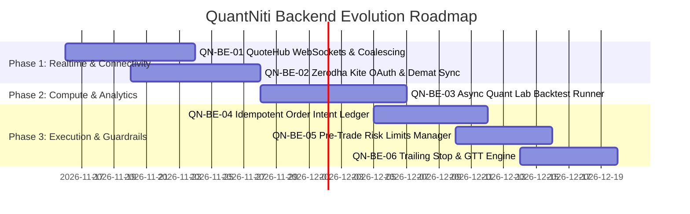

# Belltalon to QuantNiti Backend Architecture Proposal & Ticket Breakdown

**Author:** Backend & Quantitative Systems Architect  
**Target:** QuantNiti Backend (`src/app`) & Belltalon Reference Architecture (`.tmp/belltalon/be`)  
**Context:** Comparative analysis of Belltalon's hardened algorithmic execution architecture against QuantNiti's AI-driven portfolio intelligence and unsupervised regime platform.  
**Date:** November 2026  

---

## 1. Executive Summary & Architectural Context

QuantNiti has established a unique, differentiated position in the Indian retail investment space: an AI-driven portfolio intelligence and financial education platform that combines **unsupervised market regime classification** (Low-Volatility Bull, High-Volatility Bear, Sideways Consolidation), **multi-factor quantile forecasting**, and **hierarchical risk parity (HRP) basket optimization** with explainable Trust Cards and SEBI-compliant educational guardrails.

Belltalon, on the other hand, was engineered as a high-integrity, safety-critical algorithmic trading execution daemon for Indian equity and derivative markets (NSE/NFO via Zerodha Kite Connect). Belltalon's architecture (hardened across Wave 1 & Wave 2) achieves institutional-grade reliability on a modest single-server footprint ($15–$24/month AWS Lightsail) by leaning deeply into **PostgreSQL 17 ACID guarantees**, **session-level advisory locks**, **in-process WebSocket tick coalescing (`QuoteHub`)**, **durable fail-closed order intent state machines**, **interactive OAuth credential management**, and **pre-trade risk serialization**.

While QuantNiti previously added clean export seams to Belltalon (e.g. `GET /api/v1/portfolios/{id}/export/belltalon`), QuantNiti's internal backend remains largely a synchronous, virtual simulation service backed by SQLite and basic Server-Sent Events (SSE). 

This document synthesizes findings from a comprehensive code-level audit of Belltalon (`.tmp/belltalon/be`) and QuantNiti (`src/app`), identifies **six critical high-value backend capabilities**, and proposes a concrete, actionable engineering ticket breakdown. Crucially, these proposals respect **QuantNiti's lean architecture** (no heavy distributed brokers like Kafka or Redis clusters) and preserve its **unsupervised regime model** and **educational retail mission**.

---

## 2. Comparative Architecture Matrix

| Architectural Dimension | Belltalon Backend (`.tmp/belltalon/be`) | QuantNiti Current Backend (`src/app`) | Proposed Evolution for QuantNiti |
|---|---|---|---|
| **Primary Domain Mission** | Autonomous/Supervised Algorithmic Trading (Equities, Futures, Options) on Zerodha Kite. | AI Portfolio Intelligence, Unsupervised Regime Modeling, HRP Baskets, Retail Financial Literacy. | Hybrid Intelligence & Guided Execution: Regime-driven portfolio intelligence with direct broker connectivity and safe rebalancing. |
| **Process Topology** | Tri-process model: `main.py` (API), `python -m runtime` (trading daemon), `python -m worker` (backtesting). | Single-process ASGI FastAPI service (`src/app/api/app.py`) running on Uvicorn. | Single ASGI process with in-process background worker loops for lean deployment; optionally split for heavy quant jobs. |
| **Database & Persistence** | PostgreSQL 17 via SQLModel/Alembic; Advisory locks; Leased job queues (`SKIP LOCKED`); LISTEN/NOTIFY. | SQLite 3 via SQLAlchemy 2.0 ORM (`quantniti.db`); Synchronous file caching (`data/cache/`). | Upgrade to PostgreSQL (or hybrid SQLite WAL mode for local dev); adopt relational state models for orders and credentials. |
| **Real-Time Data Streaming** | `QuoteHub`: Lazily opened KiteTicker WebSocket, token ref-counting (0↔1), tick coalescing at 5Hz max, channel multiplexing. | `MarketTickGenerator` + SSE `/stream/ticks`: Synthetic Brownian motion step generator or single yfinance quote fallback. | In-Process `QuoteHub` on WebSocket `/ws`: Channel multiplexing (`quotes`, `portfolio`, `regime`, `alerts`), 5Hz coalescing, dual broker/synthetic source. |
| **Broker Integration** | Native Zerodha Kite Connect: Interactive OAuth callback, AES-256-GCM encryption at rest, 06:00 IST daily invalidation. | None (manual CSV order sheet export or JSON export seam to Belltalon). | Direct 1-Click Zerodha Kite OAuth: Read-only Demat sync (holdings, funds) and 1-click rebalance basket order submission. |
| **Order Intent & State Machine** | Durable `Order` state machine (`Submitting` pre-commit with deterministic `tag` -> `Submitted` / `Uncertain` -> `Filled`). Two-phase reconciler. | Stateless: Instant in-memory mutation of `holdings` table in SQLite; no durable intent log or timeout handling. | Idempotent Order Intent Ledger (`Submitting` -> `Submitted` -> `Filled`) guarding portfolio activations and rebalances against double-execution. |
| **Pre-Trade Risk Management** | Serialized user locking (`SELECT id FROM users FOR NO KEY UPDATE`); 4 P17 limits (loss guard, max positions, budget, exposure); margin reservation. | Static `RiskPersona` allocation bounds; no dynamic loss guards, no single-asset concentration checks, no writer locks. | Pre-Rebalance Risk Limits Manager: Max asset weight (<25%), minimum cash buffer (5%), persona drawdown guardrails, serialized user locks. |
| **Strategy Backtesting** | Asynchronous single-job worker (`worker/backtest.py`); DuckDB/Parquet storage; cooperative cancellation; bar-by-bar execution. | Synchronous Pandas vectorization (`ml/backtest/engine.py`) executed inside the HTTP request loop; single-asset only. | Asynchronous Quant Lab Runner: Multi-asset basket backtesting across historical regimes with job status polling/streaming. |
| **Triggers & Protection** | Native Kite GTT triggers (`place_gtt`, reconciliation, `pending_action`) + High-water mark trailing stops in engine. | Smart Alerts (`ml/alerts/service.py`): In-memory evaluators for RSI extremes, 52-week highs, and regime shifts; static seeds. | Persona Trailing Stop-Loss Engine (HWM tracking: Conservative 2%, Balanced 3%, Aggressive 4%) + 1-Click Kite GTT trigger sync. |
| **Compliance Posture** | SEBI Broker compliance: Interactive browser login, static IP whitelisting, approval-required live trade gating. | SEBI Advisory compliance: Educational disclaimers, Trust Cards, objective quant signals, AI Review Fact-Checking Agent. | Preserved & Strengthened: Educational Trust Cards paired with approval-required rebalance gates and audited execution receipts. |

---

## 3. Deep-Dive: 6 High-Value Backend Capabilities

### Capability 1: In-Process WebSocket `QuoteHub` with Real-Time Fanout and Tick Coalescing
* **Belltalon Reference:** `be/realtime/hub.py`, `be/realtime/ticker.py`, `be/realtime/ws.py`
* **Architectural Mechanics:**
  1. *Lazy Single-Ticker Lifecycle:* Maintains at most one `KiteTicker` WebSocket connection per connected user. The connection is opened only when the user subscribes to at least one quote or the `account` channel, and closes after a 30-second idle period when all clients disconnect.
  2. *Token Reference Counting:* Subscribing to an instrument increments a counter; token is registered with broker on 0 -> 1 and unregistered on 1 -> 0.
  3. *Tick Coalescing:* Fast incoming ticks from the exchange are held in `_Stream` buffers and flushed at a bounded frequency (default 5 Hz / 200ms). Latest tick overwrites pending ticks, completely eliminating WebSocket buffer backpressure and React DOM render thrashing.
  4. *Channel Multiplexing:* A single persistent `/ws` connection delivers multiplexed payloads:
     - `quotes {symbols}`: Coalesced price, LTP, high, low, volume, change.
     - `portfolio {portfolioId}`: Live mark-to-market total valuation and 1D P&L updates.
     - `regime {}`: Instant broadcast when the unsupervised classifier detects a macro regime transition.
     - `alerts {}`: Real-time push of Smart Alert events.
  5. *Parked Subscriptions & Auto-Resume:* If the broker ticker drops or daily credentials expire, client subscriptions enter a *parked* state and automatically resume immediately upon reconnection without client reload.
* **QuantNiti Adaptation:**
  QuantNiti's new Adaptive Desktop Workstation (`>=1024px`) displays portfolio holdings, market regime radar, and live charts simultaneously. Currently, QuantNiti uses an SSE `/stream/ticks` loop that either emits synthetic ticks every 3 seconds or makes blocking yfinance calls.
  Implementing an in-process `QuoteHub` directly in QuantNiti provides low-latency streaming to desktop and mobile clients. To preserve QuantNiti's lean architecture, the `QuoteHub` will feature a **Dual-Mode Market Provider**:
  - *Mode A (Live Broker):* When a user has connected Zerodha Kite, it feeds real NSE market ticks via `KiteTicker`.
  - *Mode B (Synthetic Brownian / Off-Market):* When disconnected or outside market hours (09:15–15:30 IST), it drives the same coalesced streams via QuantNiti's calibrated micro-Brownian step generator. The client code consumes a single, unified WebSocket API regardless of upstream mode.

---

### Capability 2: Interactive Zerodha Kite Connect OAuth Flow & Credential Encryption
* **Belltalon Reference:** `be/routers/broker_account.py`, `be/services/broker_service.py`, `be/core/security.py`
* **Architectural Mechanics:**
  1. *Regulatory Compliant Browser OAuth:* No headless scraping or automated TOTP. QuantNiti issues a signed, single-use HMAC state token valid for 10 minutes (`POST /api/v1/broker/login-url`).
  2. *Callback Exchange:* Zerodha redirects to `GET /api/v1/broker/callback?request_token=...&state=...`. The backend verifies the state signature, exchanges the token server-side for `access_token` and `public_token`, validates the broker profile, and stores encrypted credentials.
  3. *AES-256-GCM Encryption at Rest:* All credentials (`api_key`, `api_secret`, `access_token`) are encrypted with AES-256-GCM using unique 12-byte cryptographic nonces (`os.urandom(12)`) and authenticated tags. Master key is passed via `ENCRYPTION_MASTER_KEY` environment variable.
  4. *Mandatory 06:00 IST Token Expiry Sweep:* Kite tokens expire daily at 06:00 IST. A daily scheduled task sets `status = "disconnected"` and marks stored tokens expired, preventing stale requests.
  5. *Graceful Degradation via Cached Snapshots:* When the broker is disconnected or off-market, portfolio and quote endpoints serve cached snapshots marked with `source: "snapshot"`, `stale: true`, and clean diagnostic codes (`broker_token_expired`, `broker_not_connected`).
* **QuantNiti Adaptation:**
  Currently, QuantNiti users must manually inspect recommendations, download CSV order sheets, or export Belltalon JSON. By implementing Belltalon's OAuth flow:
  - Users can securely link their Zerodha account in 1 click.
  - QuantNiti can automatically import real Demat holdings into a **Live Linked Portfolio** alongside Virtual Paper Portfolios.
  - The regime classifier can run directly against the user's *actual* Demat portfolio to calculate real-world allocation drift and regime vulnerability!

---

### Capability 3: Idempotent Order Intent Ledger & Reconciliation State Machine
* **Belltalon Reference:** `be/services/execution_service.py`, `be/services/reconciler.py`, `be/models/orders.py`
* **Architectural Mechanics:**
  1. *Durable Intent Commit Before Network I/O:* Prior to dispatching any rebalance or trade order to a broker, the backend inserts an `Order` row in state `Submitting` with a unique `intent_key`, `idempotency_key`, and deterministic broker tag:
     $$\text{tag} = \text{"QN"} + \text{SHA256}(\text{intent\_key})[:18]$$
     This database transaction commits **before** opening the HTTP connection.
  2. *Out-of-Transaction Network Dispatch:* External broker API calls occur outside SQL transactions, ensuring slow network calls never tie up database connection pools.
  3. *Uncertain State Handling:* If the network times out or drops during submission, the order transitions to `Uncertain` ("Checking broker status"). It is **never blindly retried**.
  4. *Two-Phase Reconciliation Recovery:* A background reconciler queries the broker's order book (`GET /orders`) and matches orders using `tag`. If present, the true status is adopted. If absent across two consecutive polling sweeps spaced at least 30 seconds apart, the order is safely transitioned to `Rejected` (`not_found_at_broker`).
  5. *Startup Recovery Sweep:* On backend boot, `startup_recovery()` immediately transitions any dangling `Submitting` orders to `Uncertain`, forcing reconciliation before any new trade actions can be taken.
* **QuantNiti Adaptation:**
  QuantNiti's portfolio rebalancing engine currently mutates SQLite rows in-place. If a network blip occurs during a live rebalance or virtual activation, the portfolio state can desynchronize or execute duplicate transactions.
  Adopting Belltalon's idempotent intent ledger ensures that:
  - Every rebalance action (whether simulated paper or live Zerodha) generates a durable, auditable order intent.
  - Rebalance transactions are strictly idempotent; resubmitting an existing `intent_key` returns the existing state without creating duplicate trades.
  - Network timeouts are safely resolved by the reconciler without capital risk.

---

### Capability 4: Pre-Trade Risk Limits Manager & Serialized User Locking
* **Belltalon Reference:** `be/services/risk_service.py`, `be/models/orders.py`
* **Architectural Mechanics:**
  1. *Serialized User Locking:* Before assessing risk limits or committing orders, the backend acquires an exclusive row-level lock on the user's account:
     ```sql
     SELECT id FROM users WHERE id = :user_id FOR NO KEY UPDATE;
     ```
     This strictly serializes concurrent order submissions, rebalance requests, and allocations for that user, preventing race conditions that could breach cash or risk limits.
  2. *Invariants Checked:*
     - *Reduce-Only Validation:* Position exit orders must only reduce existing held quantities; an exit order can never invert into an unintended opposite-side position.
     - *Daily Loss Guard:* Evaluates realized and unrealized P&L across the IST trading day. If losses hit `daily_loss_limit`, new entries are blocked while exit orders remain permitted.
     - *Maximum Single-Asset Concentration:* Blocks allocations where any single asset exceeds risk policy limits.
     - *Margin / Cash Reservations:* Holds estimated cash/margin in a `RiskReservation` record until terminal fill settlement.
* **QuantNiti Adaptation:**
  QuantNiti's core value proposition is protecting retail investors from catastrophic downside through quantitative risk guardrails. Adopting Belltalon's pre-trade risk architecture enables QuantNiti to enforce:
  1. *Persona Concentration Caps:*
     - Conservative: No single equity > 15% of portfolio; Gold/Silver ETF minimum 20%.
     - Balanced: No single equity > 25% of portfolio; Gold ETF minimum 10%.
     - Aggressive: No single equity > 35% of portfolio.
  2. *Regime-Conditioned Drawdown Circuit Breakers:*
     - In High-Volatility Bear regimes, automatically halt fresh equity buy allocations if portfolio 1D drawdown exceeds 3.0%, directing funds into cash/GOLDBEES.
  3. *Concurrency Protection:* Prevents double-spend bugs when users rapidly tap "Apply Rebalance" on mobile devices.

---

### Capability 5: Persona Trailing Stop-Loss & Broker GTT Trigger Engine
* **Belltalon Reference:** `be/engine/evaluate.py`, `be/routers/orders.py`, `be/runtime/legs.py`, `be/services/execution_service.py`
* **Architectural Mechanics:**
  1. *High-Water Mark (HWM) Tracking:* The engine maintains a durable high-water mark for each open position:
     $$\text{HWM}_t = \max(\text{HWM}_{t-1}, \text{Price}_t)$$
     $$\text{TrailingStopPrice}_t = \text{HWM}_t \times (1 - \text{TrailingPercent})$$
  2. *Priority-Ordered Exit Hierarchy:* Belltalon evaluates exits in strict priority:
     $$\text{Stop Loss} \longrightarrow \text{Trailing Stop} \longrightarrow \text{Profit Target} \longrightarrow \text{Regime Exit}$$
  3. *Broker GTT (Good-Till-Triggered) Integration:* Filled orders can be protected by registering native exchange GTT orders with Zerodha (`POST /orders/{id}/gtt`). The position stores `protection_kind = "GTT"`, and the reconciler monitors trigger lifecycle.
* **QuantNiti Adaptation:**
  QuantNiti's `SmartAlert` engine currently alerts users when RSI is overbought or 52-week highs are broken, but it cannot actively protect unrealized profits.
  By integrating Belltalon's trailing stop mechanics:
  1. Every Virtual Paper Portfolio holding automatically tracks its High-Water Mark and dynamic Trailing Stop based on the portfolio's `RiskPersona`:
     - Conservative: 2.0% trailing stop (tight profit locking).
     - Balanced: 3.0% trailing stop (standard swing protection).
     - Aggressive: 4.0% trailing stop (wider volatility tolerance).
  2. When a trailing stop is breached, QuantNiti surfaces an urgent **Capital Protection Alert** with Trust Card rationale and generates a 1-click exit order.
  3. For live-connected Zerodha accounts, QuantNiti provides a 1-click "Arm GTT Protection" button that places native Kite GTT triggers directly at the exchange.

---

### Capability 6: Asynchronous Multi-Strategy Quant Lab Backtest Runner
* **Belltalon Reference:** `be/worker/backtest.py`, `be/worker/claim.py`, `be/services/backtest_service.py`
* **Architectural Mechanics:**
  1. *Decoupled Execution Model:* Heavy backtests run asynchronously outside the HTTP request lifecycle. The API immediately returns a `job_id` with state `queued`.
  2. *Deterministic Bar Stepping:* Evaluates multi-asset portfolios bar-by-bar across historical dates, simulating exact execution timing, slippage, and statutory charges (STT, GST, SEBI fees, Stamp Duty).
  3. *Cooperative Cancellation & Progress Heartbeats:* The worker checks `cancel_requested` at every bar step and emits progress percentages (`progress: 42%`) over WebSockets or polling endpoints.
  4. *Columnar Parquet Caching:* Historical OHLCV bars are stored in compressed Parquet partitions, allowing sub-second querying without repeated HTTP or CSV parsing.
* **QuantNiti Adaptation:**
  QuantNiti's Quant Lab (`ml/backtest/service.py`) currently runs synchronously inside `POST /api/v1/backtest/run`. This restricts users to backtesting single stocks with basic indicators (MA Crossover, RSI Reversion). If a user attempts to backtest a 15-stock regime-adaptive portfolio over 5 years, the request times out or freezes the single-threaded Python event loop.
  Adopting Belltalon's asynchronous runner enables:
  - Full **Regime-Adaptive Portfolio Basket Backtesting**: Simulating how a user's chosen basket would have performed from 2018–2024 with dynamic regime-shift rebalancing versus a static Buy-and-Hold benchmark.
  - Non-blocking client UX: The frontend displays an interactive progress bar and fetches rich performance metrics (Sharpe, Sortino, Max Drawdown, Regime Breakdown, Statutory Costs) upon completion.

---

## 4. Concrete Ticket Breakdown for QuantNiti

The following six tickets are specified in QuantNiti's standard ticket format (`.scratch/`), ordered by dependency and priority. They adhere strictly to QuantNiti's lean architecture and require no distributed infrastructure beyond SQLite/PostgreSQL and FastAPI.

```
                    ┌────────────────────────────────────────┐
                    │ QN-BE-01: WebSocket QuoteHub Engine    │
                    └──────────────────┬─────────────────────┘
                                       │
        ┌──────────────────────────────┴──────────────────────────────┐
        ▼                                                             ▼
┌────────────────────────────────────────┐   ┌────────────────────────────────────────┐
│ QN-BE-02: Zerodha Kite OAuth & Demat   │   │ QN-BE-03: Async Quant Lab Backtester   │
└──────────────────┬─────────────────────┘   └────────────────────────────────────────┘
                   │
        ┌──────────┴──────────────────────────┐
        ▼                                     ▼
┌────────────────────────────────────────┐   ┌────────────────────────────────────────┐
│ QN-BE-04: Idempotent Rebalance Ledger  │   │ QN-BE-06: Persona Trailing Stop & GTT  │
└──────────────────┬─────────────────────┘   └────────────────────────────────────────┘
                   │
                   ▼
┌────────────────────────────────────────┐
│ QN-BE-05: Pre-Trade Risk Limits Engine │
└────────────────────────────────────────┘
```

---

### Ticket QN-BE-01: In-Process WebSocket QuoteHub with Coalesced Ticks & Channel Multiplexing

* **File:** `.scratch/belltalon-proposals/issues/01-websocket-quotehub.md`
* **Title:** In-Process WebSocket QuoteHub with Coalesced Ticks & Channel Multiplexing
* **Status:** `ready-for-agent`
* **Blocked by:** None
* **Component:** `src/app/realtime/hub.py`, `src/app/api/routes/stream.py`, `src/app/core/models.py`

#### What to Build
Implement an in-process, asyncio-native `QuoteHub` on WebSocket `/ws` (and legacy SSE `/stream/ticks` adapter) that provides low-latency market data fan-out, token reference counting, and 5Hz tick coalescing to power QuantNiti's Adaptive Desktop Workstation and mobile clients.

#### Key Implementation Details
1. **`QuoteHub` Core (`src/app/realtime/hub.py`):**
   - Manage client connections in memory with channel subscriptions (`quotes`, `portfolio`, `regime`, `alerts`).
   - Token reference counting: Track unique subscriber count per symbol.
   - Dual-Source Adapter (`src/app/realtime/source.py`):
     - Primary: Broker ticker (`KiteTicker`) when user has an active connected broker account.
     - Fallback: Calibrated micro-Brownian generator (`MarketTickGenerator`) active during market hours (09:15–15:30 IST) or holding steady last-close prices off-market.
   - Tick Coalescing: Implement `_Stream` buffer flushing at most 5 events per second (200ms window) per symbol. Latest tick overwrites pending ticks in the buffer.
2. **Channel Protocol (`/ws`):**
   - Client sends JSON messages:
     - `{"action": "subscribe", "channel": "quotes", "symbols": ["RELIANCE", "^NSEI"]}`
     - `{"action": "subscribe", "channel": "portfolio", "portfolio_id": "port-123"}`
     - `{"action": "subscribe", "channel": "regime"}`
     - `{"action": "unsubscribe", "channel": "quotes", "symbols": ["RELIANCE"]}`
   - Server emits framed events:
     - `{"type": "tick", "symbol": "RELIANCE", "price": 1285.50, "change_pct": 1.2, "timestamp": "..."}`
     - `{"type": "regime_shift", "previous": "Low-Volatility Bull", "current": "High-Volatility Bear"}`
     - `{"type": "portfolio_mtm", "portfolio_id": "port-123", "current_value": 105420.0, "pnl_1d": 1200.0}`
3. **Graceful Degrade:**
   - Maintain the existing SSE endpoint `/api/v1/stream/ticks` by wrapping `QuoteHub`'s internal generator for backwards compatibility with existing clients.

#### Verification & Test Strategy
- Unit test in `tests/unit/test_quote_hub.py`:
  - Verify subscription ref-counting (0 -> 1 starts stream, 1 -> 0 stops stream).
  - Verify coalescing: Emit 100 rapid ticks in 50ms, assert at most 1 coalesced event flushed per 200ms window.
  - Verify channel multiplexing and graceful client disconnect cleanup.

---

### Ticket QN-BE-02: Secure Zerodha Kite OAuth Integration & Live Demat Holdings Ingestion

* **File:** `.scratch/belltalon-proposals/issues/02-zerodha-kite-oauth.md`
* **Title:** Secure Zerodha Kite OAuth Integration & Live Demat Holdings Ingestion
* **Status:** `ready-for-agent`
* **Blocked by:** None
* **Component:** `src/app/api/routes/broker.py`, `src/app/core/security.py`, `src/app/data/storage.py`

#### What to Build
Implement an interactive, SEBI-compliant Zerodha Kite Connect OAuth flow that allows retail users to securely link their Zerodha account in 1 click, encrypts credentials at rest with AES-256-GCM, and imports live Demat holdings/funds into QuantNiti for regime-adaptive portfolio analysis.

#### Key Implementation Details
1. **Cryptographic Storage (`src/app/core/security.py`):**
   - Implement `encrypt_credential(text: str) -> str` and `decrypt_credential(cipher: str) -> str` using `cryptography.hazmat.primitives.ciphers.aead.AESGCM` with 12-byte random nonces (`os.urandom(12)`).
   - Read 32-byte key from `ENCRYPTION_MASTER_KEY` environment variable (with fallback dev key for local testing).
2. **Database Models (`src/app/data/storage.py`):**
   - Add `BrokerAccountRecord` table:
     - `id`, `user_id` (unique), `broker_name` ("ZERODHA"), `client_id`, `user_name`, `email`.
     - `encrypted_api_key`, `encrypted_api_secret`, `encrypted_access_token`, `encrypted_public_token`.
     - `status` ("connected", "disconnected", "expired"), `token_expires_at`, `connected_at`.
   - Add `BrokerSnapshotRecord` table for caching holdings, positions, and funds with timestamp and `stale: bool`.
3. **OAuth API Endpoints (`src/app/api/routes/broker.py`):**
   - `POST /api/v1/broker/login-url`: Generates HMAC-signed state token (valid 10 mins) and returns Zerodha login URL (`https://kite.zerodha.com/connect/login?v=3&api_key=...`).
   - `GET /api/v1/broker/callback`: Verifies state, exchanges `request_token` for access token, encrypts tokens, sets `token_expires_at` to next 06:00 IST, and redirects to frontend with `?result=connected`.
   - `GET /api/v1/broker/holdings`: Returns live Demat holdings (or cached snapshot if disconnected) mapped to QuantNiti's `PortfolioHolding` schema.
   - `POST /api/v1/broker/disconnect`: Revokes session, clears encrypted tokens, and marks account disconnected.
4. **Scheduled 06:00 IST Expiry Sweep:**
   - Background routine or startup check that marks stored Zerodha accounts as `expired` past 06:00 IST.

#### Verification & Test Strategy
- Unit test in `tests/unit/test_broker_oauth.py`:
  - Test AES-256-GCM roundtrip encryption, decryption, and tamper detection (`InvalidTag`).
  - Mock Kite Connect REST client; test login URL generation, callback state verification, and token exchange.
  - Test snapshot fallback when broker token is expired.

---

### Ticket QN-BE-03: Asynchronous Quant Lab Basket Backtest Runner with Job Queue

* **File:** `.scratch/belltalon-proposals/issues/03-async-backtest-runner.md`
* **Title:** Asynchronous Quant Lab Basket Backtest Runner with Job Queue
* **Status:** `ready-for-agent`
* **Blocked by:** None
* **Component:** `src/app/ml/backtest/runner.py`, `src/app/api/routes/backtest.py`, `src/app/data/storage.py`

#### What to Build
Decouple Quant Lab backtesting from the synchronous HTTP request loop into an asynchronous background job runner, enabling multi-asset portfolio basket backtesting across historical market regimes (2018–2024) with slippage, statutory taxes, and live WebSocket progress reporting.

#### Key Implementation Details
1. **Job Queue & State Management (`src/app/data/storage.py`):**
   - Add `BacktestJobRecord` table:
     - `id`, `user_id`, `status` ("queued", "running", "succeeded", "failed", "cancelled").
     - `progress_pct` (0.0 to 100.0), `current_step_date`, `error_message`.
     - `request_payload` (JSON), `result_summary` (JSON), `created_at`, `completed_at`.
2. **Asynchronous Multi-Asset Runner (`src/app/ml/backtest/runner.py`):**
   - Execute multi-asset bar-by-bar backtest stepping across historical dates.
   - Incorporate Indian statutory taxes (STT 0.1%, GST 18%, Stamp Duty 0.015%, SEBI fees) using QuantNiti's statutory charges module (`src/app/ml/portfolio/charges.py`).
   - Simulate **Regime-Adaptive Dynamic Rebalancing**: Evaluate market regime at weekly/monthly boundaries; simulate rebalance trades when regime shifts (e.g. rotating equity to Gold ETF during High-Volatility Bear).
   - Cooperative Cancellation: Periodically check `job.cancel_requested` to abort long-running simulations without orphaned CPU threads.
3. **Endpoints (`src/app/api/routes/backtest.py`):**
   - `POST /api/v1/backtest/jobs`: Queues a backtest job, returns `{"job_id": "...", "status": "queued"}` immediately (HTTP 202 Accepted).
   - `GET /api/v1/backtest/jobs/{id}`: Returns job status, progress percentage, and final results when complete.
   - `POST /api/v1/backtest/jobs/{id}/cancel`: Sets `cancel_requested = True`.
   - Broadcast progress ticks (`{"type": "job_progress", "job_id": "...", "progress": 65}`) via `QuoteHub` on `/ws`.

#### Verification & Test Strategy
- Unit test in `tests/unit/test_async_backtester.py`:
  - Test job queuing, state transitions (`queued` -> `running` -> `succeeded`), and result retrieval.
  - Test cooperative cancellation mid-simulation.
  - Assert multi-asset regime-switching backtest matches expected mathematical benchmarks and statutory deductions.

---

### Ticket QN-BE-04: Idempotent Rebalance Order Intent Ledger & Reconciliation Engine

* **File:** `.scratch/belltalon-proposals/issues/04-idempotent-order-ledger.md`
* **Title:** Idempotent Rebalance Order Intent Ledger & Reconciliation Engine
* **Status:** `ready-for-agent`
* **Blocked by:** QN-BE-02
* **Component:** `src/app/ml/simulation/execution_ledger.py`, `src/app/api/routes/portfolio.py`, `src/app/data/storage.py`

#### What to Build
Implement an idempotent, fail-closed Order Intent Ledger and two-phase reconciliation state machine for QuantNiti portfolio activations and rebalances, ensuring that network interruptions never cause duplicate executions, double-spend errors, or orphaned positions.

#### Key Implementation Details
1. **Durable Order Ledger Schema (`src/app/data/storage.py`):**
   - Add `OrderIntentRecord` table:
     - `id`, `portfolio_id`, `intent_key` (unique), `idempotency_key` (unique), `tag` (unique).
     - `symbol`, `transaction_type` ("BUY", "SELL"), `product` ("CNC"), `quantity`, `price`.
     - `state` ("Submitting", "Submitted", "Uncertain", "Open", "Filled", "PartiallyFilled", "Cancelled", "Rejected").
     - `broker_order_id`, `filled_quantity`, `average_price`, `error_code`, `created_at`, `updated_at`.
2. **Deterministic Tag Generation:**
   - Generate broker order tag: `tag = "QN" + hashlib.sha256(intent_key.encode()).hexdigest()[:18]`.
3. **Execution Service Lifecycle (`src/app/ml/simulation/execution_ledger.py`):**
   - Step 1: Insert intent in `Submitting` state and commit to database **before** calling execution adapter.
   - Step 2: Dispatch order via adapter (simulated paper book or live Zerodha REST API).
   - Step 3:
     - Success ack -> Transition to `Submitted` / `Filled`.
     - Deterministic error -> Transition to `Rejected`.
     - Timeout / Network failure -> Transition to `Uncertain` (NEVER retry blindly).
4. **Startup Recovery & Reconciliation Sweeps:**
   - Startup Recovery: On backend launch, sweep all `Submitting` rows older than 60s into `Uncertain`.
   - Two-Phase Reconciler: Query broker order book. If order matching `tag` is found, adopt true status. If absent across 2 consecutive polls (30s apart), mark `Rejected` (`not_found_at_broker`).

#### Verification & Test Strategy
- Unit test in `tests/unit/test_execution_ledger.py`:
  - Simulate submission timeout -> verify order enters `Uncertain` state.
  - Verify startup recovery converts dangling `Submitting` intents to `Uncertain`.
  - Verify reconciler recovers true status via `tag` matching.
  - Verify duplicate submission with same `idempotency_key` returns existing intent without re-execution.

---

### Ticket QN-BE-05: Pre-Trade Risk Limits Manager & Persona Allocation Guardrails

* **File:** `.scratch/belltalon-proposals/issues/05-risk-limits-manager.md`
* **Title:** Pre-Trade Risk Limits Manager & Persona Allocation Guardrails
* **Status:** `ready-for-agent`
* **Blocked by:** QN-BE-04
* **Component:** `src/app/ml/portfolio/risk_guard.py`, `src/app/api/routes/portfolio.py`

#### What to Build
Implement a pre-trade Risk Limits Manager with serialized user locking that validates portfolio allocations and rebalancing orders against SEBI-aligned retail safety guardrails (max single-asset concentration, minimum cash reserve, persona drawdown floor, and reduce-only exit invariants).

#### Key Implementation Details
1. **Risk Limits Model (`src/app/core/models.py` & `src/app/data/storage.py`):**
   - Define `PortfolioRiskLimits`:
     - `max_single_stock_pct`: 15% (Conservative), 25% (Balanced), 35% (Aggressive).
     - `min_cash_buffer_pct`: Minimum 5% unallocated cash buffer.
     - `max_daily_drawdown_pct`: 2.5% (Conservative), 4.0% (Balanced), 6.0% (Aggressive).
     - `regime_suitability_enforced`: boolean flag.
2. **Serialized Pre-Trade Evaluation (`src/app/ml/portfolio/risk_guard.py`):**
   - Serialized Transaction Lock: In SQLite/Postgres, lock the portfolio record before evaluating risk checks to serialize concurrent rebalance requests.
   - Checks performed in order:
     1. *Reduce-Only Validation:* Any SELL order must not exceed currently held shares; naked shorting is strictly prohibited in cash delivery.
     2. *Concentration Limit:* Validate that target weights do not concentrate capital beyond the persona's single-stock cap.
     3. *Cash Buffer Invariant:* Total buy order value + estimated statutory charges must leave at least 5% cash buffer.
     4. *Regime Drawdown Circuit Breaker:* If the active regime is `High-Volatility Bear` and the portfolio has suffered >3% drawdown today, block all non-defensive equity buys, allowing only rebalances into Gold ETF or Cash.
   - Abort with HTTP 409 Conflict and a structured error envelope containing `violated_limit` and `suggested_action` if any invariant fails.

#### Verification & Test Strategy
- Unit test in `tests/unit/test_risk_limits_manager.py`:
  - Test rejection of buy orders exceeding single-stock concentration limits.
  - Test rejection of overselling (reduce-only check).
  - Test circuit breaker activation under simulated Bear regime drawdown.
  - Test that exit/sell orders are NEVER blocked by drawdown limits.

---

### Ticket QN-BE-06: Persona Trailing Stop-Loss & Broker GTT Trigger Engine

* **File:** `.scratch/belltalon-proposals/issues/06-trailing-stop-gtt-engine.md`
* **Title:** Persona Trailing Stop-Loss & Broker GTT Trigger Engine
* **Status:** `ready-for-agent`
* **Blocked by:** QN-BE-01, QN-BE-02
* **Component:** `src/app/ml/alerts/trailing_stop.py`, `src/app/ml/alerts/service.py`, `src/app/api/routes/alerts.py`

#### What to Build
Implement a high-water mark trailing stop-loss evaluator calibrated to QuantNiti's Risk Personas, generating automated capital protection alerts and providing 1-click broker GTT (Good-Till-Triggered) trigger placement for live Zerodha accounts.

#### Key Implementation Details
1. **Dynamic High-Water Mark (HWM) Tracker (`src/app/ml/alerts/trailing_stop.py`):**
   - For every active portfolio holding, track `high_water_mark = max(previous_hwm, ltp)`.
   - Calibrate trailing stop percentage to `RiskPersona`:
     - Conservative: 2.0% below HWM.
     - Balanced: 3.0% below HWM.
     - Aggressive: 4.0% below HWM.
   - Update HWM on every incoming tick from `QuoteHub`.
2. **Capital Protection Smart Alerts:**
   - When $\text{LTP} \le \text{HWM} \times (1 - \text{TrailingPct})$, immediately fire a `SmartAlert`:
     - `type`: `SmartAlertType.TRAILING_STOP_BREACH`
     - `severity`: `AlertSeverity.HIGH`
     - `title`: `🛡️ Capital Protection Stop Triggered: {symbol}`
     - `message`: `Price fell {trailing_pct}% from peak ₹{hwm:.2f} to ₹{ltp:.2f}. Trailing stop breached; recommendation: lock in gains or rebalance into defensive assets.`
     - `trust_card_context`: Mathematical trailing stop rationale.
   - Deliver via WebSocket broadcast (`/ws`) and browser Web Push.
3. **1-Click Broker GTT Sync (`src/app/api/routes/broker.py`):**
   - For users with connected Zerodha accounts:
     - `POST /api/v1/broker/holdings/{symbol}/gtt`: Places a single-leg or OCO (One-Cancels-Other) GTT trigger with Zerodha Kite using Kite's `/gtt/triggers` API.
     - Store trigger ID in `HoldingRecord.gtt_trigger_id`.
     - `DELETE /api/v1/broker/holdings/{symbol}/gtt`: Cancels active exchange GTT trigger.

#### Verification & Test Strategy
- Unit test in `tests/unit/test_trailing_stop_engine.py`:
  - Simulate ascending price series -> verify HWM ratchets upwards.
  - Simulate price pullback -> verify trailing stop alert fires exactly at threshold.
  - Test GTT payload generation conforming to Zerodha Kite Connect GTT schema.

---

## 5. Implementation Roadmap & Milestones

To maintain engineering velocity and stability, the rollout is staged across three two-week sprints:



### Phase 1: Real-Time & Connectivity Foundation (Sprint 1)
- **Focus:** Low-latency communication and broker connectivity.
- **Deliverables:** `QuoteHub` on `/ws` with 5Hz tick coalescing; interactive Zerodha OAuth flow; encrypted token storage; live Demat holdings sync.
- **Result:** Desktop workstation and mobile clients receive real-time, jitter-free market and portfolio updates; users can link their real broker accounts.

### Phase 2: Asynchronous Compute & Analytics (Sprint 2)
- **Focus:** Quant Lab upgrade and non-blocking backtesting.
- **Deliverables:** Asynchronous backtest job queue; multi-asset regime-switching backtester; WebSocket progress updates; statutory tax deductions.
- **Result:** Users can run comprehensive 5-year multi-asset portfolio simulations across historical regimes without HTTP request timeouts.

### Phase 3: Institutional Execution & Risk Guardrails (Sprint 3)
- **Focus:** Execution safety, pre-trade risk controls, and automated capital protection.
- **Deliverables:** Idempotent Order Intent Ledger; two-phase reconciler; serialized user locking; pre-trade risk limits manager; persona trailing stop-loss engine; broker GTT triggers.
- **Result:** QuantNiti provides bulletproof portfolio rebalancing and trade execution with zero risk of duplicate orders, strict concentration limits, and automated capital protection.

---

## 6. Architecture Risk Analysis & Mitigations

| Risk | Impact | Likelihood | Mitigation Strategy |
|---|---|---|---|
| **API Process Single-Worker Bottleneck** | In-process `QuoteHub` requires single Uvicorn worker process. | Medium | Sufficient for QuantNiti's current traffic (~500 concurrent connections). When horizontal scaling is required, transition `QuoteHub` cross-talk to PostgreSQL `LISTEN`/`NOTIFY` or Redis Pub/Sub. |
| **Kite API Rate Limits (3 req/sec)** | Rapid portfolio refreshes or multiple users triggering broker calls could hit Zerodha rate limits. | High | Adopt Belltalon's token bucket rate limiter (`be/services/kite_ratelimit.py`) and snapshot caching (`stale: true`) with 60-second minimum TTL for non-critical reads. |
| **Database Lock Contention** | Serialized user locking (`SELECT FOR UPDATE`) could stall requests during high concurrency. | Low | Locks are scoped strictly per-user (`WHERE user_id = :id`) and held only during brief pre-trade assessment and order commit (sub-10ms). Never hold locks across network calls. |
| **SEBI Regulatory Exposure** | Direct order execution could blur the line between educational tool and unregistered advisory. | High | Maintain QuantNiti's "Supervised Approval" model: QuantNiti never places unsupervised automated trades. All order sheets and rebalances require explicit human review and confirmation with Trust Card context. |
| **Historical Data Volume & Storage** | Storing 5 years of minute-level bars for 50 stocks in SQLite could cause database bloat. | Medium | Store historical candle archives in compressed Parquet partitions (`.parquet`) under `data/history/` queried via DuckDB, keeping SQLite strictly for relational state metadata. |

---

## 7. Conclusion

By selectively adopting the battle-tested architectural patterns from Belltalon—specifically the **in-process coalesced QuoteHub**, **fail-closed order intent ledger**, **pre-trade risk serialization**, **asynchronous backtest runner**, and **interactive Zerodha OAuth flow**—QuantNiti can evolve from a virtual portfolio prototype into an institutional-grade portfolio intelligence and execution platform.

Crucially, this evolution maintains QuantNiti's lean operational footprint, runs reliably on a modest AWS Lightsail instance, preserves its core unsupervised regime models, and upholds its educational, retail-first SEBI compliance posture.
