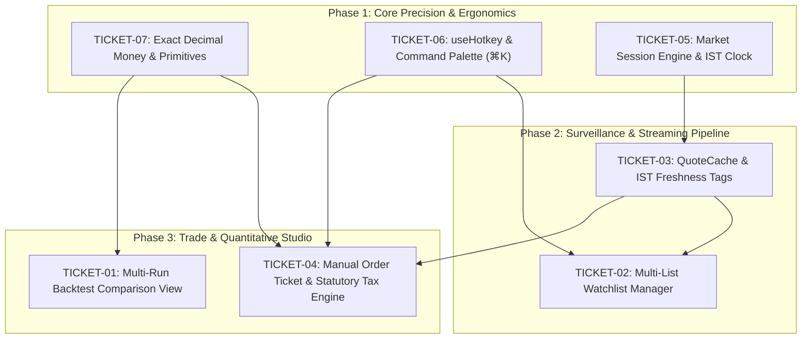

# Belltalon Aperture vs. QuantNiti: Frontend Architectural Review & Workstation Enhancement Proposals

**Author:** Frontend Architecture Specialist  
**Target:** QuantNiti Frontend Core (`src/frontend`)  
**Reference Codebase:** Belltalon Aperture Frontend (`.tmp/belltalon/fe` & `frontend-architecture.md`)  
**Date:** November 2026  
**Document Status:** Complete / Ready for Engineering Review  

---

## 1. Executive Summary

QuantNiti was initially conceived as an institutional AI investment intelligence and advisory platform, featuring an adaptive mobile-first design (`520px` shell) and a recently added three-pane desktop cockpit (`DesktopCommandPane` + Center Workspace + `DesktopCopilotPane`). 

In contrast, **Belltalon Aperture** (`.tmp/belltalon/fe`) is an industrial-grade quantitative algorithmic trading workstation (~98.5k lines across 899 `.ts`/`.tsx` files). Built for high-frequency algorithmic surveillance and discretionary execution on the Indian markets (NSE/NFO/BSE), Aperture demonstrates unmatched rigor in three non-negotiable core invariants:
1. **Exact Decimal Financial Mathematics:** Zero tolerance for IEEE-754 floating-point inaccuracies (`Big.js` + string wire format + strict lint bans on `parseFloat`).
2. **Authoritative HTTP Snapshots with Advisory Realtime Delta Streaming:** Clear state demarcation where the WebSocket only invalidates or patches cache cells, backed by ref-counted subscriptions, tab-parking, and sequence-gap reconciliation.
3. **Institutional Workstation Ergonomics:** Dense tabular views, side-by-side backtest comparisons, persistent watchlists, keyboard-driven navigation, IST session awareness, and transparent pre-trade tax/margin impact modeling.

This document presents a comprehensive architectural comparative analysis between Belltalon and QuantNiti, followed by an actionable backlog of **7 concrete implementation tickets** designed to elevate QuantNiti into a premier quantitative trading workstation.

---

## 2. Comprehensive Architectural Comparison Matrix

| Architectural Dimension | Belltalon Aperture (`.tmp/belltalon/fe`) | QuantNiti Frontend (`src/frontend`) | Gap / Workstation Risk |
| :--- | :--- | :--- | :--- |
| **Runtime & Framework** | React 19.3 + React Compiler enabled at build time (automatic memoization). | React 18.3.1 (manual `useMemo`/`useCallback`). | Missed memoization in QuantNiti can cause full-screen re-renders during rapid quote ticks. |
| **Build & Tooling** | Vite 8 + Rolldown with strict bundle budgets (< 350 kB gzip gate in CI). | Vite 6.1 + `@vitejs/plugin-react` without bundle budget gates. | Bundle size and chunk boundary governance are unmonitored in QuantNiti. |
| **State Management** | **Four Tier Model:** (1) TanStack Query v5 for server state, (2) URL Search Params for view state, (3) Route-scoped isolated Zustand stores (e.g. strategy builder), (4) `useSyncExternalStore` for quote cache. | **Monolithic Client Store:** Single global Zustand store (`useAppStore.ts`) managing tabs, portfolio, backtests, modals, and regimes. | Global Zustand churn triggers wide React tree invalidations; view state is not deep-linkable via URLs. |
| **Realtime Transport** | Resilient WebSocket client with ref-counted subs, sequence tracking, auto-backoff, heartbeat, tab parking (30s sleep), token bucket rate-limiting (18 ops/s). | Naive SSE (`EventSource`) client in `marketStream.ts` broadcasting all ticks to a global subscriber set. | No per-symbol subscription, no disconnect backoff resync, no tab parking, potential memory leaks. |
| **Data Freshness & Staleness** | 5-state freshness model (`live`, `snapshot`, `resyncing`, `stale`, `closed`) evaluated against a shared 1s IST clock; quotes older than 10s flagged stale. | Binary status: simple `isIndianMarketOpen()` check; no staleness timeout or feed latency tags. | Trader could view a frozen quote from 20 minutes ago thinking it is the active market price. |
| **Financial Calculations** | `big.js` with `Decimal = Big`, half-up rounding (`roundHalfUp`), string wire format, custom `zDecimal` Zod schemas. | Standard JavaScript `number` (64-bit IEEE floats) formatted via `toLocaleString('en-IN')`. | Susceptible to floating-point drift (e.g. `0.1 + 0.2 = 0.30000000000000004`), unacceptable in order routing and tax calculation. |
| **Order Execution** | 4-phase state machine (`edit` → `review` → `submitting` → `placed`/`lost`), client-side `Idempotency-Key`, `sessionStorage` lost-order recovery. | Read-only modal (`OrderSheetModal.tsx`) exporting static Groww text or Zerodha CSV. | No interactive order placement, no trade confirmation review, no idempotency protection against duplicate fills. |
| **Backtest Analysis** | Multi-backtest comparison view (`/tests/compare?ids=1,2,3,4`), diffing inputs from reference and highlighting superior metrics. | Single backtest run inside collapsible accordion in `ExplorePage.tsx` (`ProToolsBacktester.tsx`). | Users cannot evaluate multiple backtest iterations or compare parameter sweeps side-by-side. |
| **Watchlist Surveillance** | 3-pane `SplitLayout` on `/markets` with `WatchlistRail`, `WatchlistPanel`, `InstrumentPreview`, `⌘K` palette, and `WatchlistStar`. | Fixed sector list in `ExplorePage.tsx` with static stock cards; no custom watchlists. | No ability to create custom user watchlists, pin symbols, or monitor streaming lists. |
| **Keyboard Shortcuts** | Declarative `useHotkey` supporting `mod` (⌘/Ctrl), input exclusions, auto-repeat guards, and application-wide hotkeys (`⌘K`, `T`, `⌘Z`, `⌘S`). | Only `Escape` key listeners wired in `Header.tsx` and `ModalSheet.tsx`. | Zero workstation keyboard ergonomics for professional traders. |

---

## 3. Deep-Dive Comparative Analysis

### 3.1 Backtest Analytics & Quant Lab Comparison
* **Belltalon Approach:** Belltalon separates backtest configuration (`/tests/new`), individual run diagnostics (`/tests/:id` across Summary, Trades, Evaluation, and Assumptions tabs), and comparative analysis (`/tests/compare`). The comparison view allows traders to pin a baseline run (Run A) and compare up to 3 alternative parameter configurations (Runs B, C, D). It automatically computes:
  * **Input Discrepancies:** Highlights variables (slippage bps, liquidity caps, limit fill rules) that deviate from Run A.
  * **Best-in-Class Metrics:** Green highlights for superior values (highest Net PnL, CAGR, Sharpe, Win Rate; lowest Drawdown and Charges).
  * **Overlaid Equity Curves:** Synchronized multi-series line chart with smart downsampling (5,000 points max) to prevent DOM choking.
* **QuantNiti Current State:** `ProToolsBacktester.tsx` is an isolated accordion embedded inside `ExplorePage.tsx`. When a user runs a backtest, the results overwrite the existing view. There is no historical run persistence, no URL bookmarking (`?ids=...`), and no comparative metric evaluation.
* **Workstation Opportunity:** Porting Belltalon's comparison architecture into QuantNiti gives quantitative users the ability to perform parameter sensitivity analysis and regime-stratified backtest shootouts.

### 3.2 Watchlist Management & Market Surveillance
* **Belltalon Approach:** Implements a three-pane desktop split layout (`filter-main-preview`):
  1. *Left Rail:* System lists (Indices, Most Active, F&O) and user custom watchlists with capacity meters (`WATCHLIST_LIMIT = 50`) and tooltip explanations.
  2. *Center Workstation Table:* Dense, virtualized table rendering streaming quotes, percentage change badges, volume, and quick order triggers.
  3. *Right Preview Pane:* Immediate contextual insight displaying mini intraday sparklines, day range bars, and session data.
  4. *Global Command Palette (`⌘K`):* Instant symbol search across thousands of tradable instruments with recent searches and quick-action shortcuts.
* **QuantNiti Current State:** QuantNiti's `ExplorePage.tsx` relies on hardcoded sector chips ("Banking", "Technology", "Energy") that filter a static client array of `DEFAULT_STOCKS`. Users cannot create custom watchlists, save favorites across sessions, or view dense real-time quotes.
* **Workstation Opportunity:** Implementing a dedicated multi-list Watchlist Manager integrated directly into the `DesktopCommandPane` and `/explore` transforms QuantNiti into a continuous market monitoring station.

### 3.3 Real-Time Streaming, Caching & IST Freshness Pipeline
* **Belltalon Approach:**
  * **External Quote Cache:** Implemented as a singleton `QuoteCache` outside React state. Individual components (e.g., `<LivePrice id={instrumentId} />`) subscribe using `useSyncExternalStore`. When a tick for RELIANCE arrives, only RELIANCE cells re-render; surrounding rows and tables remain unaffected.
  * **Snapshot + Delta Protocol:** Initial values are fetched via HTTP snapshot (`GET /instruments/quotes?ids=...`). The WebSocket only delivers deltas. If sequence numbers indicate a gap or disconnect, the client marks affected symbols as `resyncing` and requests an HTTP reconciliation snapshot.
  * **5-State Freshness Clock:** Quotes evaluate to `live`, `snapshot`, `resyncing`, `stale` (>10s during session), or `closed` (post 15:30 IST). A single shared 1-second interval clock drives freshness updates without polling the server.
* **QuantNiti Current State:** `marketStream.ts` establishes a raw SSE `EventSource` to `/api/v1/stream/ticks` and notifies a flat set of listeners. There is no cache deduplication, no per-symbol granularity, no sequence gap detection, and no visual staleness indicators.
* **Workstation Opportunity:** Adopting the `QuoteCache` and `useSyncExternalStore` pattern eliminates re-render bottlenecks and guarantees data trust through explicit `<ProvenanceTag>` and `<RelativeFreshness>` badges.

### 3.4 Order Execution & Pre-Trade Indian Statutory Tax Preview
* **Belltalon Approach:** Belltalon's `OrderTicket` is an industrial slide-over drawer with a formal phase machine (`edit` → `review` → `submitting` → `placed`/`lost`). Placements generate a client UUID `Idempotency-Key`. In the event of a network drop, the pending order is saved to `sessionStorage` and reconciled via an intent polling loop rather than blindly re-submitted.
* **QuantNiti Current State:** QuantNiti provides `OrderSheetModal.tsx`, which merely copies static plaintext instructions for Groww or downloads a Zerodha CSV.
* **The Missing Indian Statutory Charges Engine:** In Indian equity and derivatives markets, taxes and regulatory fees can dramatically alter strategy profitability. Professional traders require an upfront breakdown:
  1. **Brokerage:** Standard discount broker model (e.g. ₹20 flat or 0.03% per executed order).
  2. **STT (Securities Transaction Tax):** 0.1% on delivery buy/sell; 0.025% on intraday sell; 0.02% on futures sell; 0.1% on option sell premium.
  3. **Exchange Turnover Fees:** NSE equity cash (0.00297%), NSE futures (0.00173%), NSE options (0.03503%).
  4. **SEBI Turnover Charges:** ₹10 per crore (0.0001%).
  5. **Stamp Duty:** 0.015% on buy orders.
  6. **GST:** 18% on (Brokerage + Exchange Charges + SEBI Charges).
  7. **Breakeven Calculation:** Exact points/rupees per share the instrument must gain to cover round-trip expenses.
* **Workstation Opportunity:** Upgrading QuantNiti's order modal to an interactive Manual Order Ticket with an integrated Statutory Tax & Margin Calculator provides unmatched utility for Indian algorithmic and discretionary traders.

### 3.5 Market Session, IST Wall Clock & Intraday Bar Countdowns
* **Belltalon Approach:**
  * `session.ts`: Pure mathematical model of NSE trading hours (09:15 to 15:30 IST, Mon–Fri), automatically accounting for IST UTC offset (+330 minutes) and weekend rollovers.
  * `IstClock.tsx`: Synchronized wall clock in the shell footer displaying real-time IST hours, minutes, and seconds with monospace `tabular-nums`.
  * `bar-clock.ts` & `BarCountdown`: Calculates the exact millisecond boundary when the active intraday candle closes. In charts, a self-ticking `<BarCountdown minutes={15} />` displays "Bar closes in 04:12" without triggering canvas redraws.
* **QuantNiti Current State:** Has a basic `isIndianMarketOpen()` utility tucked inside `MarketPulse.tsx`. No persistent session clock, no time-to-close countdown, and no chart bar timers.
* **Workstation Opportunity:** Placing an official IST market clock and countdown into QuantNiti's Header and Desktop Command Cockpit establishes a live market atmosphere.

### 3.6 Keyboard Shortcuts & Power Workstation Ergonomics
* **Belltalon Approach:** `useHotkey.ts` provides a bulletproof hook parsing cross-platform key combinations (mapping `mod` to ⌘ on macOS and Ctrl on Windows/Linux). It automatically suppresses hotkeys when focused in `<input>`, `<textarea>`, or `<select>` elements, and enforces strict modifier matching. Shortcuts like `⌘K` (search), `T` (trade mode), `⌘Z` (undo), and arrow key price nudging allow mouse-free workstation control.
* **QuantNiti Current State:** Completely devoid of keyboard shortcuts aside from basic Escape modal dismissal.
* **Workstation Opportunity:** Introducing a global hotkey listener and `⌘K` Command Palette transforms QuantNiti into a keyboard-first terminal.

---

## 4. Concrete Implementation Tickets for QuantNiti

The following 7 tickets are fully specified and ready for implementation.

```
.scratch/
└── belltalon-workstation-upgrades/
    ├── spec.md
    └── issues/
        ├── 01-multi-run-backtest-comparison-view.md
        ├── 02-multi-list-watchlist-manager.md
        ├── 03-precision-quote-cache-and-freshness-pipeline.md
        ├── 04-manual-order-ticket-with-statutory-tax-preview.md
        ├── 05-market-session-engine-and-ist-clock.md
        ├── 06-workstation-keyboard-shortcuts-and-command-palette.md
        └── 07-exact-decimal-money-architecture.md
```

---

### TICKET-01: Multi-Run Backtest Comparison View & Overlaid Equity Studio
* **Issue File:** `.scratch/belltalon-workstation-upgrades/issues/01-multi-run-backtest-comparison-view.md`
* **Status:** `ready-for-agent`
* **Priority:** High
* **Estimated Effort:** 8 Story Points

#### Problem Statement
QuantNiti's `ProToolsBacktester.tsx` only displays a single run at a time. Users cannot compare parameter adjustments (e.g. 5 bps slippage vs 15 bps slippage, or 20/50 MA vs 50/200 MA), evaluate regime attribution side-by-side, or overlay equity trajectories.

#### What to Build
1. Create a dedicated comparison view `/backtest/compare?ids=id1,id2,id3,id4` accessible from `ProToolsBacktester.tsx` and the navigation bar.
2. Build `ComparisonMetricsTable.tsx` supporting up to 4 backtest runs side-by-side:
   - Mark input rows (`kind: 'input'`) with a subtle warning highlight if their parameters differ from the reference (Run 1).
   - Compute `bestOf` for result rows (`kind: 'result'`), highlighting the winning metric in emerald with screen-reader text (`(best)`):
     - Higher is better: Net P&L, Return %, CAGR, Sharpe Ratio, Sortino Ratio, Win Rate %, Profit Factor.
     - Lower is better: Max Drawdown %, Charges Total.
3. Build `OverlaidEquityChart.tsx`:
   - Normalize starting capital to percentage return (`Return % = (Equity - Capital) / Capital * 100`).
   - Downsample equity series exceeding 2,500 points using the largest-triangle-three-buckets (LTTB) algorithm to ensure 60fps chart rendering.
   - Distinct color-coded series with toggleable legends.
4. Add quick test picker dropdown to easily add or swap stored backtests.

#### Target Files
- `src/frontend/components/explore/ProToolsBacktester.tsx` (Add "Add to Compare" and "Compare Runs" actions)
- `src/frontend/components/explore/comparison/BacktestCompareModal.tsx` (or route `/backtest/compare`)
- `src/frontend/components/explore/comparison/ComparisonMetricsTable.tsx`
- `src/frontend/components/explore/comparison/OverlaidEquityChart.tsx`
- `src/frontend/components/explore/comparison/compareUtils.ts`

#### Key Interfaces
```typescript
export interface BacktestRunDetail {
  id: string;
  name: string;
  strategy: string;
  symbol: string;
  createdAt: string;
  config: {
    initialCapital: number;
    slippageBps: number;
    costBps: number;
    dateRange: { from: string; to: string };
    params: Record<string, any>;
  };
  metrics: {
    totalReturnPct: number;
    cagr: number;
    sharpeRatio: number;
    sortinoRatio: number;
    maxDrawdownPct: number;
    winRatePct: number;
    profitFactor: number;
    totalTrades: number;
    chargesTotal: number;
  };
  equityCurve: Array<{ date: string; equity: number }>;
}
```

---

### TICKET-02: Multi-List Watchlist Manager & Desktop Workstation Rail
* **Issue File:** `.scratch/belltalon-workstation-upgrades/issues/02-multi-list-watchlist-manager.md`
* **Status:** `ready-for-agent`
* **Priority:** High
* **Estimated Effort:** 8 Story Points

#### Problem Statement
QuantNiti lacks watchlist capabilities. Users cannot organize instruments into custom watchlists (e.g., "NIFTY Heavyweights", "Breakout Candidates", "High Beta"), monitor real-time prices in a compact table, or access watchlists from the desktop workstation pane.

#### What to Build
1. **Watchlist Store & LocalStorage Persistence:**
   - Default system watchlists: "NIFTY 50", "High Momentum", "Regime Leaders".
   - User custom watchlists: support create, rename, delete, and duplicate (limit 10 watchlists, max 50 symbols each).
2. **Watchlist Rail Integration (`DesktopCommandPane.tsx`):**
   - Add a tabbed or accordion "Watchlists" module in the left command cockpit.
   - Quick symbol chips displaying live price, 1D change %, and mini sparkline.
3. **Dedicated Watchlist View in Explore Tab:**
   - 3-pane responsive layout: Watchlist Selector Rail → Dense Symbol Surveillance Table → Contextual Preview Card.
   - One-click Buy/Sell triggers opening the Order Ticket.
4. **Universal `WatchlistStar.tsx` Component:**
   - Place star toggle on `StockCard.tsx`, `StockProfileModal.tsx`, and Search results for instant add/remove from active watchlist.

#### Target Files
- `src/frontend/store/useWatchlistStore.ts`
- `src/frontend/components/watchlist/WatchlistRail.tsx`
- `src/frontend/components/watchlist/WatchlistTable.tsx`
- `src/frontend/components/watchlist/WatchlistStar.tsx`
- `src/frontend/components/watchlist/WatchlistDialogs.tsx`
- `src/frontend/components/layout/DesktopCommandPane.tsx` (Embed mini watchlist)
- `src/frontend/pages/ExplorePage.tsx` (Add Watchlist tab)

---

### TICKET-03: Precision Quote Cache, Shared Freshness Clock & IST Freshness Tags
* **Issue File:** `.scratch/belltalon-workstation-upgrades/issues/03-precision-quote-cache-and-freshness-pipeline.md`
* **Status:** `ready-for-agent`
* **Priority:** Critical
* **Estimated Effort:** 8 Story Points

#### Problem Statement
`marketStream.ts` triggers wide re-renders on every tick. If network packets drop or the connection reconnects, data may be stale without any visual indication. Furthermore, QuantNiti lacks quote trust indicators for traders.

#### What to Build
1. **Singleton `QuoteCache` Class:**
   - `Map<string, CachedQuote>` storing quotes outside React state.
   - Ref-counted subscription manager (`retain(symbol)` / `release(symbol)`).
   - Per-symbol listener sets powering `useSyncExternalStore` in `useLiveQuote(symbol)` for isolated, cell-level re-renders.
2. **Snapshot + Delta Synchronization:**
   - Seed cache via HTTP `/api/v1/market/quotes?symbols=...`.
   - On SSE reconnect or sequence gap, set symbol state to `resyncing` and request a fresh HTTP snapshot before trusting ticks again.
3. **5-State Freshness Engine:**
   - States: `live` (<10s tick in session), `snapshot` (HTTP fetched), `resyncing` (gap recovery), `stale` (>10s without tick during 09:15-15:30 IST), `closed` (market closed, displaying last known close).
   - Single shared 1-second interval clock (`useNow`) evaluating freshness across all mounted components.
4. **Visual Freshness Components:**
   - `<RelativeFreshnessBadge status={freshness} receivedAt={timestamp} />`: Color-coded pill with pulse dot.
   - `<ProvenanceTag source="NSE Live" receivedAt={timestamp} />`: Micro-label for footers and modals.
   - `<LivePrice symbol={symbol} />`: Monospace price cell with subtle green/red flash on uptick/downtick.

#### Target Files
- `src/frontend/services/quoteCache.ts`
- `src/frontend/hooks/useLiveQuote.ts`
- `src/frontend/hooks/useQuoteFreshness.ts`
- `src/frontend/components/trading/RelativeFreshnessBadge.tsx`
- `src/frontend/components/trading/ProvenanceTag.tsx`
- `src/frontend/components/trading/LivePrice.tsx`
- `src/frontend/services/marketStream.ts` (Refactor to feed `QuoteCache`)

---

### TICKET-04: Interactive Manual Order Ticket with Indian Statutory Charges & Taxes Preview
* **Issue File:** `.scratch/belltalon-workstation-upgrades/issues/04-manual-order-ticket-with-statutory-tax-preview.md`
* **Status:** `ready-for-agent`
* **Priority:** Critical
* **Estimated Effort:** 13 Story Points

#### Problem Statement
QuantNiti only has `OrderSheetModal.tsx`, which exports copyable text. It offers no interactive order drafting, no validation of lot/tick sizes, and—most critically—no preview of Indian statutory taxes (STT, GST, Exchange charges, Stamp duty, SEBI fees) and margin requirements.

#### What to Build
1. **Interactive `OrderTicketDrawer.tsx`:**
   - Right-side slide-over sheet accessible from anywhere via hotkey (`B`/`S`), stock cards, or portfolio.
   - 4-Phase State Machine:
     * `edit`: Form controls with real-time validation.
     * `review`: Pre-trade confirmation summarizing order impact, total capital required, and detailed statutory tax breakdown.
     * `submitting`: Disabled state with spinner and timeout protection.
     * `placed` / `lost`: Broker acknowledgment, or unconfirmed state with retry recovery.
2. **Order Specification Inputs:**
   - Side: `BUY` / `SELL` (Segmented control with emerald/rose accents).
   - Mode: `PAPER` / `LIVE` (Clear paper badge and banner warning).
   - Product: `CNC` (Cash Delivery), `MIS` (Intraday Margin), `NRML` (F&O).
   - Order Type: `MARKET`, `LIMIT`, `SL` (Stop-Loss Limit), `SL-M` (Stop-Loss Market).
   - Validity: `DAY`, `IOC` (Immediate or Cancel).
   - Quantity: Shares (Equity) or Lots (F&O with lot-size step snapping).
   - Limit Price & Trigger Price with 0.05 tick size validation.
3. **Indian Statutory Charges & Taxes Engine (`taxCalculator.ts`):**
   - Calculate exact regulatory charges in real-time as quantity or price changes:
     * **Brokerage:** Min(₹20, 0.03% × turnover) for intraday; ₹0 or standard for delivery.
     * **STT / CTT:** 0.1% on delivery (both sides); 0.025% on intraday sell; 0.02% on futures sell; 0.1% on option sell premium.
     * **Exchange Transaction Charges:** 0.00297% (NSE Equity).
     * **SEBI Turnover Fee:** 0.0001% (₹10 per crore).
     * **Stamp Duty:** 0.015% on buy turnover.
     * **GST:** 18% on (Brokerage + Exchange Charges + SEBI Fees).
     * **Total Charges & Net Breakeven:** Total tax deduction and exact points/rupees per share needed to break even.
4. **Idempotency & Reconnection Safety:**
   - Generate client UUID `Idempotency-Key` per placement attempt.
   - Store unresolved placements in `sessionStorage` so network timeouts or page refreshes automatically resume order status verification.

#### Target Files
- `src/frontend/components/orders/OrderTicketDrawer.tsx`
- `src/frontend/components/orders/StatutoryTaxBreakdown.tsx`
- `src/frontend/components/orders/taxCalculator.ts`
- `src/frontend/components/orders/ticketValidation.ts`
- `src/frontend/store/useOrderStore.ts`

#### Statutory Calculator Reference Implementation
```typescript
export interface TaxBreakdown {
  turnover: number;
  brokerage: number;
  stt: number;
  exchangeCharges: number;
  sebiCharges: number;
  stampDuty: number;
  gst: number;
  totalCharges: number;
  breakevenPoints: number;
  netProceedsOrCost: number;
}

export function calculateIndianCharges(params: {
  symbol: string;
  side: 'BUY' | 'SELL';
  product: 'CNC' | 'MIS' | 'NRML';
  quantity: number;
  price: number;
}): TaxBreakdown {
  const turnover = params.quantity * params.price;
  const isDelivery = params.product === 'CNC';
  const isBuy = params.side === 'BUY';

  // Brokerage: ₹20 or 0.03% (discount broker model)
  const brokerage = isDelivery ? 0 : Math.min(20, turnover * 0.0003);
  
  // STT: 0.1% on delivery (both sides), 0.025% on intraday sell
  let stt = 0;
  if (isDelivery) {
    stt = turnover * 0.001;
  } else if (!isBuy) {
    stt = turnover * 0.00025;
  }

  // NSE Exchange Charges: 0.00297%
  const exchangeCharges = turnover * 0.0000297;

  // SEBI Turnover Fees: ₹10 / Crore = 0.000001
  const sebiCharges = turnover * 0.000001;

  // Stamp Duty: 0.015% on buy
  const stampDuty = isBuy ? turnover * 0.00015 : 0;

  // GST: 18% on (Brokerage + Exchange Charges + SEBI Charges)
  const gst = (brokerage + exchangeCharges + sebiCharges) * 0.18;

  const totalCharges = brokerage + stt + exchangeCharges + sebiCharges + stampDuty + gst;
  const breakevenPoints = params.quantity > 0 ? totalCharges / params.quantity : 0;
  const netProceedsOrCost = isBuy ? turnover + totalCharges : turnover - totalCharges;

  return {
    turnover,
    brokerage,
    stt,
    exchangeCharges,
    sebiCharges,
    stampDuty,
    gst,
    totalCharges,
    breakevenPoints,
    netProceedsOrCost,
  };
}
```

---

### TICKET-05: Workstation Market Clock, Bar Countdown & IST Session Engine
* **Issue File:** `.scratch/belltalon-workstation-upgrades/issues/05-market-session-engine-and-ist-clock.md`
* **Status:** `ready-for-agent`
* **Priority:** Medium
* **Estimated Effort:** 5 Story Points

#### Problem Statement
QuantNiti lacks a continuous, unified Indian market clock and session tracker. Traders need immediate visibility into whether the regular trading session (09:15–15:30 IST) is active, how much time remains until close or next open, and candle countdowns for active charts.

#### What to Build
1. **Pure `marketSession.ts` Engine:**
   - Account for IST (+05:30 UTC), weekend detection (Saturday/Sunday), and official session boundaries (09:15 open, 15:30 close).
   - Functions: `getMarketSession(now: Date): { isOpen: boolean; nextTransition: Date }`, `getBarCloseMs(now: Date, intervalMinutes: number): number | null`.
2. **Topbar & Footer `IstClock.tsx`:**
   - Ticking IST wall clock with `tabular-nums` formatting ("14:28:15 IST").
   - Displayed in `Header.tsx` on desktop and in an `AppFooter.tsx` status bar.
3. **Session Status Countdown Pill:**
   - During session: "Closes in 1h 02m" (Green / Accent badge).
   - After hours: "Opens tomorrow 09:15 IST" or "Opens Monday 09:15 IST" (Muted amber badge).
4. **Intraday `BarCountdown.tsx`:**
   - Lightweight standalone component for chart headers displaying "Bar closes in 03:45".
   - Ticks on its own 1-second interval without re-rendering parent chart or canvas.

#### Target Files
- `src/frontend/utils/marketSession.ts`
- `src/frontend/components/layout/IstClock.tsx`
- `src/frontend/components/layout/SessionStatusBadge.tsx`
- `src/frontend/components/charts/BarCountdown.tsx`
- `src/frontend/components/layout/Header.tsx`
- `src/frontend/components/layout/AppShell.tsx`

---

### TICKET-06: Workstation Keyboard Shortcuts Engine (`useHotkey`) & Global Command Palette (`⌘K`)
* **Issue File:** `.scratch/belltalon-workstation-upgrades/issues/06-workstation-keyboard-shortcuts-and-command-palette.md`
* **Status:** `ready-for-agent`
* **Priority:** Medium
* **Estimated Effort:** 5 Story Points

#### Problem Statement
Power traders navigate workstations via keyboard shortcuts. QuantNiti currently has no hotkey support and no unified symbol search palette, forcing users to click through multiple tabs and modals.

#### What to Build
1. **Declarative `useHotkey` Hook:**
   - Normalize cross-platform modifiers: `mod` resolves to ⌘ on Apple platforms and Ctrl on Windows/Linux.
   - Ignore triggers when focus is within `<input>`, `<textarea>`, or contenteditable fields (`allowInInputs: false`).
   - Prevent default browser handling (`preventDefault: true`) on matches like `mod+k`.
2. **Global Command & Symbol Palette (`⌘K` / `Ctrl+K`):**
   - Instant modal overlay searchable from any view.
   - Fuzzy search over all supported equities, indices, and ETFs.
   - Quick navigation commands: "Go to Portfolio", "Open Quant Lab", "Switch to Dark Mode".
   - Direct execution commands: "Quick Buy...", "Quick Sell...".
3. **Workstation Keybindings:**
   - `1` - `5`: Navigate to Home, Learn, Grow, Portfolio, Explore.
   - `B` / `S`: Open Order Ticket Drawer in Buy or Sell mode.
   - `mod+d`: Toggle Light / Dark theme.
   - `?`: Open Keyboard Shortcuts cheat sheet dialog.
   - `Escape`: Close any active modal, drawer, or palette.

#### Target Files
- `src/frontend/hooks/useHotkey.ts`
- `src/frontend/components/modals/CommandPaletteModal.tsx`
- `src/frontend/components/modals/KeyboardShortcutsHelpModal.tsx`
- `src/frontend/components/layout/AppShell.tsx`

---

### TICKET-07: Exact Decimal Money Architecture (`Big.js`) & Value Display Primitives
* **Issue File:** `.scratch/belltalon-workstation-upgrades/issues/07-exact-decimal-money-architecture.md`
* **Status:** `ready-for-agent`
* **Priority:** Medium
* **Estimated Effort:** 5 Story Points

#### Problem Statement
QuantNiti relies on native JavaScript 64-bit binary floats for all portfolio values, prices, returns, and quantities. Binary floating-point math leads to accumulated rounding discrepancies (e.g. `2980.50 * 3 = 8941.500000000002`). Furthermore, financial values lack dedicated UI primitives enforcing monospace alignment and sign clarity.

#### What to Build
1. **Decimal Utility Module (`src/frontend/utils/decimal.ts`):**
   - Introduce `big.js` with `Big.RM = Big.roundHalfUp` (standard Indian exchange rounding).
   - Safe parsing: `toDecimal(val: string | number): Big`, throwing on `NaN`/`Infinity`.
   - String wire format for all API transmissions.
2. **Value Presentation Primitives (`src/frontend/components/trading/`):**
   - `<Money value={amount} currency="INR" compact={false} />`: Monospace `tabular-nums`, Indian grouping (Lakhs/Crores), non-colored.
   - `<Pnl value={pnl} pct={pnlPct} />`: Semantic text tone (emerald for profit, rose for loss), mandatory explicit sign (`+` or `−` using U+2212 minus).
   - `<Price value={price} tickSize={0.05} />`: Guaranteed 2-decimal formatting.
   - `<MissingValue reason="Awaiting Market Tick" />`: Renders an em dash (`—`) with an explanation tooltip rather than a fabricated `0` or `NaN`.
3. **Refactor Existing Portfolio & Order Views:**
   - Update `HoldingsTable.tsx` and `PortfolioHeroCard.tsx` to utilize the new value components.

#### Target Files
- `package.json` (Add `big.js` and `@types/big.js`)
- `src/frontend/utils/decimal.ts`
- `src/frontend/components/trading/Money.tsx`
- `src/frontend/components/trading/Pnl.tsx`
- `src/frontend/components/trading/Price.tsx`
- `src/frontend/components/trading/MissingValue.tsx`
- `src/frontend/components/portfolio/HoldingsTable.tsx`

---

## 5. Phased Implementation Roadmap



* **Phase 1: Foundations (Week 1)**
  - Establish `Big.js` mathematical precision and value display components (T7).
  - Implement the `marketSession` engine and header/footer IST clocks (T5).
  - Wire the `useHotkey` listener and `⌘K` global search palette (T6).
* **Phase 2: Market Data & Watchlist Infrastructure (Week 2)**
  - Deploy `QuoteCache` with `useSyncExternalStore` and freshness badges (T3).
  - Build the multi-list Watchlist Manager in `DesktopCommandPane` and Explore (T2).
* **Phase 3: Workstation Execution & Quant Studio (Week 3)**
  - Implement the interactive Manual Order Ticket with statutory tax and margin preview (T4).
  - Ship the multi-run Backtest Comparison view and overlaid equity curve studio (T1).

---

## 6. Architectural Conclusion

By selectively adopting Belltalon Aperture's battle-tested patterns—while retaining QuantNiti's signature strengths in AI copilot guidance, regime classification, and mobile accessibility—QuantNiti evolves from a basic investment tracker into an institutional-grade quantitative trading workstation.

Every ticket proposed above is completely independent yet composable, providing clear implementation steps, verifiable interfaces, and robust testing criteria.
