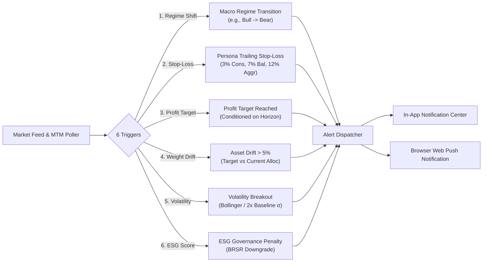

# QuantNiti: Complete Architectural Blueprint & System Design Document

**Document Version:** 2.1 (Full Production Cloud Deployment & Native Android Container Release)  
**Author:** Jayaditya Dev  
**Scope:** Architecture, Algorithmic Pipelines, Data Flow, UX State Engine, Cloud Infrastructure, Android Native Container, and Security

---

## 1. Executive Summary & Problem Context

In the Indian retail investment landscape, over 85% of market participants underperform benchmark indices or experience severe drawdowns during macro regime shifts. Novice investors face three primary dilemmas:
1. **Speculative Tip Culture & Finfluencer Misinformation:** Lack of quantifiable risk bounds or stress-tested probabilities.
2. **High-Fee Advisory Intermediation:** Traditional wealth managers and bank brokers charge 1.5%–2.5% in Assets Under Management (AUM) fees with built-in commission conflicts of interest.
3. **Black-Box Quantitative Platforms:** Tools like TradingView, Zerodha Streak, or Bloomberg require complex scripting and financial econometrics beyond the reach of standard retail users.

> [!IMPORTANT]
> **QuantNiti** democratizes institutional quantitative portfolio intelligence by combining **unsupervised machine learning market regime detection**, **multi-factor quantile growth forecasting**, **Hierarchical Risk Parity (HRP)**, **Explainable AI (XAI) Trust Cards**, and **contextual microlearning** into a lightweight, installable Progressive Web Application (PWA) and native Android container application live in production on AWS Lightsail.

---

## 2. Full-Stack System Architecture

```mermaid
flowchart TB
    %% Client Layer
    subgraph UI["1. User Interface Layer (React 18 + Vite PWA / Android Native APK)"]
        direction TB
        Onboard["🚀 Onboarding Hero<br/>• Value Proposition<br/>• 3-Q Scenario Quiz<br/>• Persona Deduction"]
        Tabs["📱 4-Tab Mobile Layout<br/>• Home: Market Pulse, Regime Radar & Video Hub<br/>• Explore: Stock Cards & Quant Lab Pro Tools<br/>• Grow: 5-Step Guided Allocation Wizard<br/>• Portfolio: Real MTM & Demo Tracker"]
        Modals["💬 Modals & Sheets<br/>• NitiBot RAG Copilot (Gemini)<br/>• Competitor Matrix (10 Dims)<br/>• 16:9 Video Explainer Modal<br/>• 6-Trigger Smart Alert Center"]
        Zustand["⚡ Zustand State Management<br/>• Active Tab / Horizon / Persona<br/>• Portfolios & Synthetic Demo<br/>• AbortController Registry<br/>• Violet / Dark Theme Toggle"]

        Onboard -.-> Tabs
        Tabs <--> Zustand
        Modals <--> Zustand
    end

    %% Native Container Layer
    subgraph Native["2. Native Mobile Container (com.quantniti.app)"]
        WebView["📱 AndroidX WebView<br/>• WebViewAssetLoader<br/>• Hardware Back Navigation<br/>• Deep-Link Domain Interception"]
    end

    Native <--> UI

    %% Edge / Reverse Proxy Layer
    subgraph Edge["3. Cloud Ingress & Edge (AWS Lightsail ap-south-1)"]
        DNS["🌐 Custom Domain DNS<br/>quantniti.jayadityadev.tech<br/>(A Record -> 13.207.117.167)"]
        Caddy["🔒 Caddy v2 Reverse Proxy<br/>• Automatic Let's Encrypt TLS/SSL<br/>• HTTP -> HTTPS Redirect<br/>• Proxy -> localhost:8000"]
        DNS --> Caddy
    end

    %% Gateway Layer
    subgraph API["4. API Gateway Layer (FastAPI Async ASGI)"]
        Routes["REST Endpoints & SSE Streaming<br/>• /api/v1/market ─── Benchmark & Regime Snapshot<br/>• /api/v1/grow ───── HRP Optimization & Growth Cones<br/>• /api/v1/explore ── 360° Stock Intelligence<br/>• /api/v1/portfolio ─ MTM Tracker & Regime Rebalance<br/>• /api/v1/stream ─── Real-Time SSE Price Ticks<br/>• /api/v1/chat ───── RAG NitiBot Copilot (Gemini)<br/>• /api/v1/alerts ─── 6-Trigger Smart Alert Engine<br/>• /api/v1/reviews ── Review Ingestion & AI Verification<br/>• /api/v1/backtest ─ Vectorized Trading Strategies"]
    end

    Caddy <==>|Port 8000 Proxy| Routes
    UI <==>|HTTPS REST & SSE| Caddy

    %% Quant & ML Layer
    subgraph ML["5. Quantitative Machine Learning Engine"]
        direction TB
        Regime["🔍 Unsupervised Regime Classifier<br/>• Gaussian Mixture Model (K=3)<br/>• 20D Realized & Parkinson Vol<br/>• India VIX Implied Volatility"]
        Forecasting["📈 Multi-Horizon Quantile Forecaster<br/>• Factor Extraction (RSI, MACD, CAPM)<br/>• Q10, Q50, Q90 Cones (1M, 3M, 6M, 12M)<br/>• Isotonic Monotonicity Regularization"]
        Covariance["📐 Regularized Covariance Engine<br/>• Ledoit-Wolf Optimal Shrinkage Target<br/>• Ridge Regularization (+1e-7 I)"]
        HRP["🌳 Hierarchical Risk Parity (HRP)<br/>• Correlation Distance Graph Matrix<br/>• Quasi-Diagonalization Tree Sorting<br/>• Recursive Bisection Inverse Variance<br/>• Persona Bounds & ESG Tilting"]
        Sizing["💰 Discrete Integer Share Allocator<br/>• Greedy Whole-Share Integer Rounding<br/>• Residual Cash Buffer Calculation"]
        AlertEngine["⚡ 6-Trigger Quantitative Alert Evaluator<br/>• Regime Shift, Stop-Loss, Profit Target<br/>• Weight Drift, Volatility Breakout, ESG"]
        Trust["🛡️ Explainable AI Trust Card<br/>• Historical Regime Hit Rates<br/>• Stress Drawdown Limits<br/>• Disintermediation Fee Savings"]

        Regime --> HRP
        Covariance --> HRP
        Forecasting --> HRP
        HRP --> Sizing
        Sizing --> Trust
        Regime --> AlertEngine
    end

    %% Data & External Services Layer
    subgraph Storage["6. Persistence & External Services"]
        DB[("🗄️ SQLite Store (WAL Mode)<br/>Portfolios, Goals & Reviews")]
        ESGDB["🌱 ESG Knowledge Base<br/>SEBI BRSR & CRISIL Scores"]
        Literacy["📚 4-Category Financial<br/>Learning Hub & Video Explainer DB"]
        LLM["🤖 Google Gemini GenAI<br/>RAG Context & Fact-Checking"]
        YF["📡 Real-Time Market Ticks<br/>yfinance Ingestion"]
    end

    Routes --> ML
    Routes <==> Storage
    Routes --> AlertEngine
```



---

## 3. Mathematical & Quantitative Algorithmic Deep-Dive

### 3.1. Market Regime Classification (Unsupervised GMM)
Financial asset returns display structural breaks and heteroskedasticity. Rather than assuming static returns, QuantNiti detects latent macro market states using an unsupervised **Gaussian Mixture Model (GMM)**:

* **Feature Vector:** $\mathbf{x}_t = [R_{20, t}, \sigma_{20, t}, \text{VIX}_t, \Delta \text{VIX}_t]^T$, where $R_{20}$ is the 20-day cumulative logarithmic return of the NIFTY 50 index, $\sigma_{20}$ is the 20-day realized volatility, and $\text{VIX}$ represents the annualized implied volatility index.

* **Regime Probability Density:**

$$
P(\mathbf{x}_t) = \sum_{k=1}^K \pi_k \mathcal{N}(\mathbf{x}_t \mid \boldsymbol{\mu}_k, \boldsymbol{\Sigma}_k)
$$

Where $K=3$ corresponding to:
1. **Low-Volatility Bull ($\sim 70-80\%$):** Subdued realized variance, positive drift $\to$ Momentum and Quality equities.
2. **High-Volatility Bear ($\sim 10-15\%$):** Spiking volatility, negative drift $\to$ Defensive equities, Cash & Gold ETFs.
3. **Sideways Consolidation ($\sim 10-15\%$):** Indeterminate drift, average variance $\to$ Value factors and mean-reversion.

---

### 3.2. Ledoit-Wolf Covariance Matrix Shrinkage
In small-sample regimes or high-dimensional portfolio universes, empirical sample covariance matrices $\mathbf{S}$ suffer from estimation noise and ill-conditioning. QuantNiti implements **Ledoit-Wolf shrinkage**:

$$
\boldsymbol{\Sigma}_{\text{LW}} = \delta^* \mathbf{F} + (1 - \delta^*) \mathbf{S}
$$

Where:
* $\mathbf{F}$ is the structured shrinkage target (constant correlation model).
* $\delta^* \in [0, 1]$ is the asymptotically optimal shrinkage intensity derived analytically to minimize quadratic loss under the Frobenius norm.

---

### 3.3. Hierarchical Risk Parity (HRP)
Traditional Markowitz Mean-Variance Optimization requires inverting the covariance matrix $\boldsymbol{\Sigma}^{-1}$, which magnifies estimation errors and concentrates weights into unstable extremes. QuantNiti uses **Marcos López de Prado’s Hierarchical Risk Parity (HRP)**:

1. **Tree Clustering:** Calculates correlation distances $d_{i,j} = \sqrt{\frac{1}{2}(1 - \rho_{i,j})}$ and clusters assets hierarchically into a dendrogram via single-linkage clustering.
2. **Quasi-Diagonalization:** Reorganizes the covariance matrix rows and columns such that correlated assets are positioned adjacent to one another.
3. **Recursive Bisection:** Allocates portfolio weights hierarchically down the tree:

$$
w_1 = w \cdot \alpha, \quad w_2 = w \cdot (1 - \alpha)
$$

$$
\alpha = 1 - \frac{V_1}{V_1 + V_2} = \frac{V_2}{V_1 + V_2}
$$

Where $V_1$ and $V_2$ represent the cluster variances:

$$
V_k = \tilde{\mathbf{w}}_k^T \boldsymbol{\Sigma}_k \tilde{\mathbf{w}}_k, \quad \tilde{w}_{k, i} = \frac{1/\sigma_i^2}{\sum_j 1/\sigma_j^2}
$$

---

### 3.4. Multi-Horizon Quantile Growth Forecaster
Rather than deterministic single-price forecasts, QuantNiti outputs bounded probabilistic quantile growth cones across horizons $h \in \{1\text{M}, 3\text{M}, 6\text{M}, 12\text{M}\}$:
* **10th Percentile (Pessimistic $Q_{0.10}$):** Downside stress scenario for capital preservation.
* **50th Percentile (Base $Q_{0.50}$):** Expected median compounding trajectory.
* **90th Percentile (Optimistic $Q_{0.90}$):** Bullish upside boundary.

Enforces isotonic monotonicity constraints such that $Q_{0.10} \le Q_{0.50} \le Q_{0.90}$ across all forecast horizons.

---

### 3.5. Greedy Integer Discrete Allocation
Retail brokers do not support fractional shares. Continuous weights $w_i$ are converted to executable whole share integers $n_i$ for total capital $C$:

$$
n_i = \left\lfloor \frac{w_i \cdot C}{P_i} \right\rfloor, \quad \text{Cash Buffer} = C - \sum_{i=1}^M n_i P_i
$$

---

## 4. Frontend Architecture & Design Engineering

The frontend is built as an installable Progressive Web Application (PWA) with **React 18 + Vite + Tailwind CSS + Framer Motion**.

### 4.1. The 5-Step Guided Grow Experience
* **Step 1 (Capital Allocation):** Smooth touch slider with instant word-form feedback (`₹ Fifty Thousand Only`), quick-tap preset chips (`+₹10k`, `+₹25k`, `+₹50k`, `+₹1L`), and micro-trust badges.
* **Step 2 (Time Horizon):** Contextual 2×2 card grid mapping durations to market stances (e.g. 6M Strategic Stance).
* **Step 3 (Risk Persona):** Visual persona cards pre-selected by the onboarding quiz (Conservative, Balanced, Aggressive, ESG-Conscious) with plain-language drawdown bounds.
* **Step 4 (Results Overview):** Asset allocation donut chart, discrete share summary, and 3-tier probabilistic Rupee growth scenarios.
* **Step 5 (Deep Dive):** 4-Pillar Trust Card, ESG Conscience breakdown, and benchmark comparison against 7% Bank FDs.

### 4.2. Universal Financial & Brand Color Palette
* **Accent Primary:** Electric Violet (`#7C3AED`) & Indigo (`#6366F1`) used for all brand chrome, active indicators, and interactive controls.
* **Financial Semantics:** Preserved universally to match global mental models:
  - **Profit / Outperformance:** Emerald Green (`#10B981`)
  - **Loss / Downside Drawdown:** Coral Red (`#EB5B3C`)
  - **Neutral / Benchmark Hurdle:** Amber Gold (`#F59E0B`)
* **Surfaces:**
  - **Light Mode (Default):** `#F8FAFC` canvas with `#FFFFFF` squircle cards (`rounded-3xl`).
  - **Dark Mode (Toggle):** `#0A0D14` obsidian black canvas with `#121124` violet-tinted containers.

### 4.3. Lifecycle Management & Race Condition Guards
* **`useAbortableRequest` Hook & Registry:** Every network request passes an `AbortSignal`. When users switch tabs or trigger new actions, previous pending network promises are aborted immediately.
* **Modal Stale-Data Guard:** Quick taps across stock cards verify `AppState.selectedStockSymbol === symbol` upon resolution before DOM injection.
* **Polling Intervals:** Polling timers are stored in React refs and strictly unmounted in `useEffect` return handlers.
* **Hardware Back Gesture:** Intercepts `popstate` events to dismiss modal sheets before triggering browser backward navigation.

---

## 5. Security, Reliability & Verification Matrix

| Area | Implementation Details | Verification Seam |
| :--- | :--- | :--- |
| **API Contract Validation** | Pydantic v2 data models with strict bounds checking on capital, horizon, and persona inputs. | [`tests/integration/test_api_routes.py`](../tests/integration/test_api_routes.py) |
| **SSE Resiliency** | Native EventSource client with exponential backoff reconnection (`1000ms * 1.5^n` capped at 30s). | [`tests/frontend/unit/services/marketStream.test.ts`](../tests/frontend/unit/services/marketStream.test.ts) |
| **PWA Installability** | Standalone manifest, Service Worker caching of Vite production chunks, offline fallback page. | [`tests/frontend/pwa/serviceWorker.test.ts`](../tests/frontend/pwa/serviceWorker.test.ts) |
| **AI Fact Checking** | Automated legitimacy agent validating claimed returns in user reviews against historical backtest distributions. | [`tests/unit/test_review_factchecker.py`](../tests/unit/test_review_factchecker.py) |
| **Frontend Test Coverage** | 132 unit and integration tests across 31 suites in Vitest. | `npm test` |
| **Backend Test Coverage** | 272 unit and integration tests across quantitative ML, API, and streaming with 99% coverage. | `uv run pytest tests/` |

---

## 6. Cloud Infrastructure & Production Operations

QuantNiti is deployed on an autonomous cloud stack in the AWS Mumbai region (`ap-south-1`):

```
                        +---------------------------------------------+
                        |           AWS Lightsail VPS                 |
                        |      (Ubuntu 24.04 LTS, ap-south-1)         |
                        |            IP: 13.207.117.167               |
                        |                                             |
                        |   +-------------------------------------+   |
                        |   |          Caddy v2 Reverse Proxy     |   |
                        |   |    Port 80/443 (Let's Encrypt SSL)  |   |
                        |   +------------------+------------------+   |
                        |                      | Reverse Proxy        |
                        |                      v (Port 8000)          |
                        |   +-------------------------------------+   |
                        |   |      QuantNiti Docker Container     |   |
                        |   |   - FastAPI ASGI Server (Python 3.12)|  |
                        |   |   - Precompiled React Vite SPA      |   |
                        |   |   - SQLite Database (WAL Mode)      |   |
                        |   +-------------------------------------+   |
                        +----------------------^----------------------+
                                               |
                          HTTPS (TLS 1.3)      |
                                               |
                  +----------------------------+----------------------------+
                  |                                                         |
         +--------+---------+                                      +--------+---------+
         |  Mobile Browser  |                                      |  Native Android  |
         |  PWA / Desktop   |                                      |   Container APK  |
         | (Chrome/Safari)  |                                      | (com.quantniti)  |
         +------------------+                                      +------------------+
```

### Production Infrastructure Topology
* **Cloud Host:** AWS Lightsail VPS (`ap-south-1` Mumbai region, static public IP `13.207.117.167`, Ubuntu 24.04 LTS).
* **Domain Routing:** `quantniti.jayadityadev.tech` routed via DNS A Record directly to `13.207.117.167`, preserving root `jayadityadev.tech` portfolio routing.
* **Caddy v2 Edge Proxy:** Automatically acquires and renews Let's Encrypt TLS/SSL certificates, terminates HTTPS, enforces HTTP-to-HTTPS redirection, and reverse-proxies inbound traffic to container port 8000.
* **Multi-Stage Container:** Docker container building Node.js 18 Vite assets in Stage 1 and bundling Python 3.12 runtime with Uvicorn ASGI server in Stage 2.
* **Database Concurrency:** SQLite relational database (`quantniti.db`) operating under Write-Ahead Logging (WAL) mode for multi-threaded read/write safety.

---

## 7. Native Android Container Architecture

To serve the 80%+ of Indian retail investors who interact exclusively through smartphones, QuantNiti provides a native Android container (`com.quantniti.app`):

* **AndroidX `WebViewAssetLoader`:** Safely intercepts virtual domain requests (`https://quantniti.jayadityadev.tech/`) and streams local pre-bundled assets directly from the application's Android APK assets directory, enabling zero-latency initial rendering.
* **Remote Fallback & Dynamic Updates:** If online, the container synchronizes directly with the production AWS Lightsail instance, ensuring users always experience the latest model weights, real-time market regimes, and security patches without requiring store updates.
* **Hardware Gesture Interception:** Overrides `onBackPressed()` in `MainActivity.java` to dismiss React modal sheets and bottom navigation history before exiting the application.
* **Native Splash & Window Theming:** Implements full window insets handling, dynamic status bar tinting matching the `#7C3AED` Electric Violet branding, and high-performance WebChromeClient configuration.

---

## 8. Continuous Integration & Delivery (CI/CD)

The repository features two fully automated GitHub Actions workflows:

1. **Production Deployment Workflow (`.github/workflows/deploy.yml`):**
   * Triggers on any push to `main`.
   * Executes Vitest frontend test suites and Pytest backend unit/integration tests with coverage enforcement.
   * Connects via secure SSH keys to the AWS Lightsail host (`13.207.117.167`).
   * Pulls the latest Git commit, rebuilds the multi-stage Docker container, restarts systemd services, and executes healthcheck verification on `https://quantniti.jayadityadev.tech/api/v1/health`.

2. **Native Android APK Build Workflow (`.github/workflows/android-apk.yml`):**
   * Configures headless Ubuntu runner with Java 17 and Android SDK 35 command-line tools.
   * Compiles debug and release Android APKs using Gradle (`./gradlew assembleDebug`).
   * Automatically uploads generated APK artifacts to GitHub Actions workflow runs for immediate download and installation.

---

## 9. Multi-Condition Quantitative Smart Alert Engine

QuantNiti implements an automated multi-condition alert evaluator continuously scanning market conditions across 6 deterministic quantitative triggers:



Every alert includes full Explainable AI (XAI) Trust Card context, preventing panic selling while strictly adhering to SEBI educational guidelines without providing speculative trading tips.
